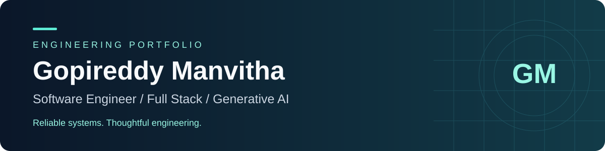

<strong>Software Engineer · Full-Stack Development · Generative AI</strong>

Building reliable applications, intelligent systems and testable software.

<a href="https://www.linkedin.com/in/gopireddymanvitha/">LinkedIn</a> ·
<a href="https://manvithagopireddy.github.io/Manvithaportfolio/">Portfolio</a> ·
<a href="https://leetcode.com/u/gLJ2E1bNWI/">LeetCode</a> ·
<a href="mailto:gopireddymanvitha@gmail.com">Email</a>

---

## Selected engineering projects

| Project | Engineering focus | Stack |
|---|---|---|
| [RAGBOT](https://github.com/Manvithagopireddy/RAGBOT) | Hybrid document retrieval, reranking, cited answers and streaming | Python, FastAPI, FAISS, React, TypeScript |
| [EduNexus](https://github.com/Manvithagopireddy/School-management-system) | School management, REST services and algorithmic features | Java, Spring Boot, React, SQLite |
| [TestingPro](https://github.com/Manvithagopireddy/TestingPro) | API validation, integration tests, BDD and continuous integration | Node.js, Jest, Postman, Cucumber |
| [AerospaceBot](https://github.com/Manvithagopireddy/AerospaceBot) | Domain-focused space and astronomy assistant with conversation persistence | JavaScript, Express, Gemini, SQLite |
| [Olist E-commerce Analysis](https://github.com/Manvithagopireddy/Olist_Ecommerce_Analysis) | Marketplace analytics, logistics and customer satisfaction | SQL, Python, Power BI |
| [Developer Portfolio](https://github.com/Manvithagopireddy/Manvithaportfolio) | Responsive portfolio and automated deployment | React, Vite, GitHub Pages |

Explore each repository for its implementation, documentation and available test or build instructions.

## About

I am a Computer Science and Engineering graduate (2025) with professional software engineering experience at BristleTech. My interests span full-stack applications, retrieval-augmented AI, software quality and enterprise technology.

- B.Tech in Computer Science and Engineering · CGPA 8.11/10
- Based in India · Open to relocation and full-time opportunities
- Currently learning SAP Basis, SAP HANA and enterprise system administration

## Technical toolkit

| Area | Technologies |
|---|---|
| Programming | Java, Python, JavaScript, TypeScript, SQL |
| Frontend | React, Next.js, React Native, Tailwind CSS |
| Backend | Node.js, Express, Spring Boot, FastAPI, REST APIs |
| Data | MongoDB, Firebase, PostgreSQL, MySQL, SQLite |
| AI | RAG, LangChain, LangGraph, FAISS, Gemini |
| Quality | Playwright, Selenium, Pytest, Postman, API testing |
| Cloud & delivery | AWS, Azure, Git, GitHub Actions |
| Analytics | Power BI, SQL, Pandas |

## Professional experience

**BristleTech — Software Engineering | 2025–2026**

Worked on web and mobile applications, backend APIs, AI workflows, data reporting and software testing in collaborative development environments.

## Professional learning

AWS Cloud Practitioner Essentials · SAP Learning courses · Ongoing study of enterprise technology and cloud administration.

## Engineering approach

I value maintainable code, clear documentation, reproducible setup instructions, meaningful tests and transparent project limitations.

---

<strong>Open to software engineering, AI and enterprise technology opportunities.</strong>

<a href="https://www.linkedin.com/in/gopireddymanvitha/">Let's connect</a>

